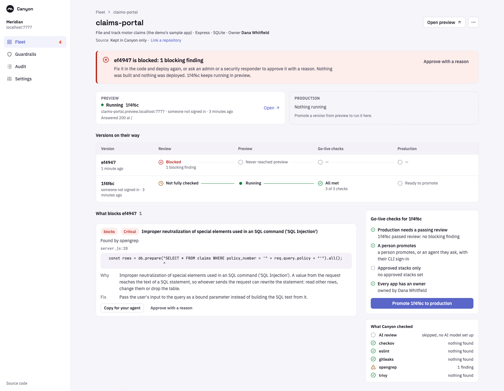
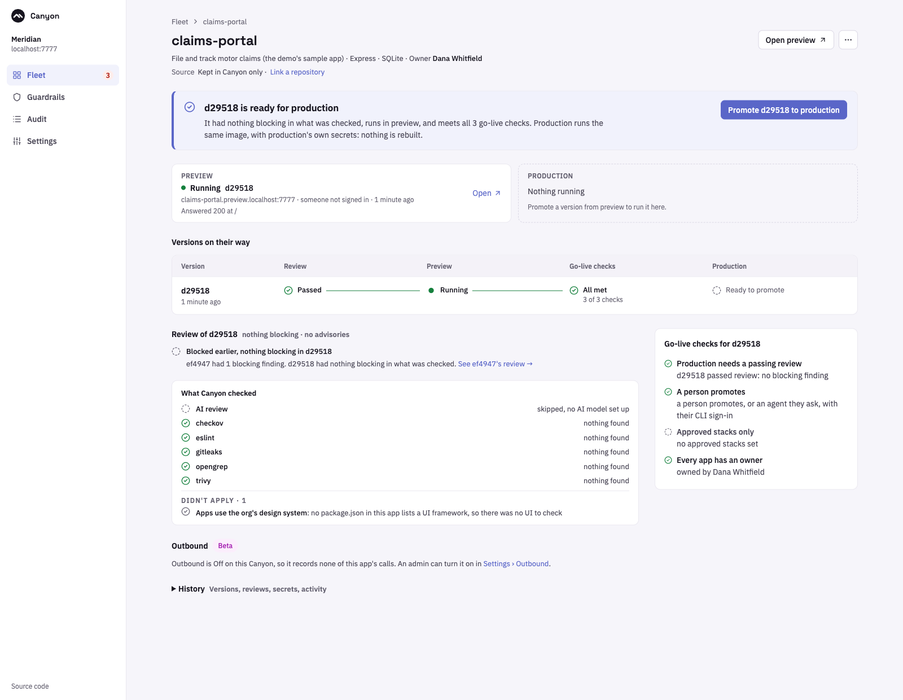

  <a href="https://www.getcanyon.ai/">
    <picture>
      <source media="(prefers-color-scheme: dark)" srcset="https://raw.githubusercontent.com/getcanyon-ai/canyon/main/.github/assets/canyon-mark-dark.svg">
      
    </picture>
  </a>

## Your coding agents ship apps. Canyon reviews every deploy.

Canyon is an open-source review gate and app platform for software built with AI. Your agent deploys, Canyon checks the code against your org's rules, the agent gets findings it can fix, and a person promotes to production. It runs on your laptop or your Kubernetes.

| 1. Your agent deploys | 2. Canyon checks it | 3. A person promotes |
|---|---|---|
| `canyon deploy` from Claude Code, Codex or Cursor. | Open-source scanners, and an AI review when you give it a model, check every version against your org's rules. A blocking finding stops the deploy and tells the agent how to fix it. | Production only takes a version that passed review, and a person decides when it goes live. |

  <picture>
    <source media="(prefers-color-scheme: dark)" srcset="https://raw.githubusercontent.com/getcanyon-ai/.github/main/profile/img/01-blocked-dark.png">
    
  </picture>
  <picture>
    <source media="(prefers-color-scheme: dark)" srcset="https://raw.githubusercontent.com/getcanyon-ai/.github/main/profile/img/02-passed-dark.png">
    
  </picture>

Blocked: the agent built SQL from the request. · Passed: after the agent's one-line fix.

### Where to start

  
  
  

- **Try it on your laptop.** Paste one prompt into Claude Code, Codex or Cursor. It starts a demo Canyon and walks you through a blocked deploy, the fix, and production. → https://www.getcanyon.ai/docs/start/take-the-tour/
- **Run it for your team.** Install Canyon on your own Kubernetes, with your team's sign-in. → https://www.getcanyon.ai/docs/self-host/kubernetes/
- **Contribute.** Read CONTRIBUTING, then pick an open issue. → https://github.com/getcanyon-ai/canyon/blob/main/CONTRIBUTING.md

The core is AGPL-3.0, the CLI and contracts are Apache-2.0, and ee/ is under the Elastic License 2.0. Report security issues privately through the repository's Security tab.
